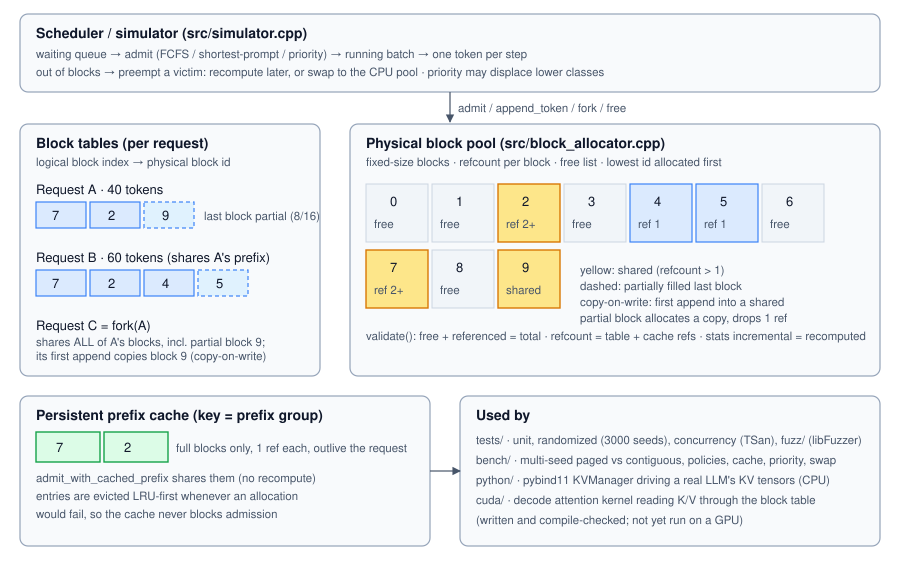

# paged-kv-cache-manager

[](https://github.com/prathameshpranjale/paged-kv-cache-manager/actions/workflows/ci.yml)
[](LICENSE)


A **paged KV-cache manager and continuous-batching scheduler** for LLM serving, written in C++17. It re-implements the memory-management
idea behind PagedAttention (Kwon et al., SOSP 2023) as a learning project, and comes with:

- a **step-based simulator** that compares paged allocation against contiguous reservation,
- a **Python / pybind11 harness** that runs real LLMs (Qwen2.5-0.5B, TinyLlama-1.1B) on top of the *real* C++ block manager,
- a **CUDA paged decode-attention kernel** (written and compile-checked, **not yet run on a GPU**).



> **Status:** milestones M0 to M5 are done and verified on CPU. **M6 (running the CUDA kernel on a GPU) is the remaining work.** No GPU
> number exists in this repository; see [`cuda/GPU_CHECKLIST.md`](cuda/GPU_CHECKLIST.md).

## Why paging

A decoding LLM keeps a key/value (KV) cache for every request. The simple approach reserves one contiguous buffer per request, sized for the
longest possible context, and most of it sits unused. Paging splits the cache into small fixed-size **blocks** handed out on demand through a
per-request **block table**, which also lets requests **share** blocks (common prompts, parallel samples) and lets the scheduler **preempt**
requests when memory runs out.

## Highlights

| | Result (simulated, 5 seeds, 1500 requests per run, block size 16) |
|---|---|
| Memory utilization | **98.3%** paged vs 21.7% for max-length reservation (scenario A) |
| Concurrent requests | **3.7x** more than max-length reservation (115 vs 31); 1.2x more than an *oracle* that knows each request's final length |
| p95 latency | 494 steps vs 9,271 (about 19x lower) |
| Prefix cache | prefill tokens computed: 912,458 without sharing, **224,945** with live sharing + persistent cache |
| Priority + preemption | high-priority p95 latency **248** steps vs about 3,950 under FCFS |
| Correctness on a real LLM | Qwen2.5-0.5B fp32 **54/54** checks; paged vs unpaged layout is **bit-exact** (`torch.equal`) |
| Test suite | 55 tests, clean under ASan, UBSan, TSan; 102k+ fuzz executions without a crash; 93 to 100% line coverage |
| Allocator speed | about 3 ns per allocate/release (single thread, Release) |

The simulator measures **memory management and scheduling, not GPU speed**. Rates for prefill and swap are assumptions and are labelled as such.

## What is implemented

| Area | What |
|---|---|
| Block manager (`include/kvpage`, `src`) | fixed-size blocks, free list, refcounts; block tables; `KVManager` with `admit`, `admit_with_prefix` (share full blocks), `fork` (share all blocks), `append_token` with **copy-on-write**, `free`, a **persistent LRU prefix cache** reclaimed under memory pressure, and O(1) `stats()` cross-checked against a from-scratch recount in `validate()` |
| Scheduler / simulator | continuous batching; **FCFS**, **shortest-prompt-first** and **priority** policies (priority can preempt lower classes); preemption by **recompute** or **swap to a CPU pool**; optional cost model; parallel sampling (fork + COW); watermark; seeded workload generator |
| Baselines | contiguous reservation of the whole context window (`maxlen`) and of the exact final length (`oracle`) |
| Real-model harness (`python/`) | pybind11 module over the real `KVManager`; Qwen2 and Llama architectures with K/V stored per block; compared against Hugging Face |
| CUDA (`cuda/`) | fp16 K/V, fp32 math decode-attention kernel reading K/V through the block table; correctness test; bandwidth benchmark; PyTorch SDPA baseline script. **Not yet run.** |

Rules the manager enforces: a request with `n` tokens owns `ceil(n/B)` blocks (only the last may be partial); prefix sharing shares only
completely filled blocks; the first append into a *shared partial* block (after `fork`) copies it; `append_token` fails without changing
state when no block can be found (after reclaiming the prefix cache), and the scheduler then preempts a victim.

## Quick start

Needs Linux or WSL, g++ 9+ or clang, CMake 3.16+.

```bash
git clone https://github.com/prathameshpranjale/paged-kv-cache-manager.git
cd paged-kv-cache-manager

./scripts/test.sh fast     # build + the 55 tests (Debug, invariants checked on every operation)
./scripts/ci.sh            # what CI runs: tests + ASan/UBSan + TSan + a benchmark smoke run
./scripts/bench.sh         # simulator benchmark -> results/results.md, results.csv, plots
```

Other scripts:

| Script | Purpose |
|---|---|
| `scripts/compilers.sh` | g++ and clang++ with `-Wall -Wextra -Wpedantic -Wshadow -Werror` |
| `scripts/coverage.sh` | gcov line coverage of `src/` |
| `scripts/fuzz.sh 60` | libFuzzer (clang) on `KVManager`, 60 seconds |
| `scripts/cpu_bench.sh` | CPU timing of the code itself -> `results/cpu_benchmark.md` |
| `scripts/model_check.sh` | real-LLM checks (needs the Python setup below) |
| `scripts/cuda_compile_check.sh` | compile-only check of `cuda/*.cu` with clang (no GPU needed) |

`bench.sh` and `model_check.sh` write into `results/`. To keep the committed reports, use `--out FILE` (model check) or restore with
`git checkout -- results/` afterwards.

### Real-model checks (Python)

```bash
python3 -m venv ~/kvenv && . ~/kvenv/bin/activate
pip install torch --index-url https://download.pytorch.org/whl/cpu
pip install transformers pybind11 numpy
export HF_HOME=/path/with/space          # models are downloaded here
./scripts/model_check.sh --dtype bf16 --quick --out /tmp/model_check_bf16.md
```

Default is Qwen2.5-0.5B-Instruct in fp32 (about 5 to 10 minutes, about 3 GB RAM). For models above 1B parameters use `--dtype bf16 --quick`.

## Verification (what was actually run)

All runs below are on CPU. They were run on two machines (WSL2 Ubuntu 24.04, g++ 13.3 and clang++ 18); the second run reproduced the same pass counts.

| Check | Result |
|---|---|
| `test.sh` | 55 tests pass in the normal build and under ASan+UBSan; the 4 concurrency tests pass under TSan |
| Randomized tests | 3000 seeded KV-manager sequences (shadow model, every invariant checked after every operation, failures shrunk to a minimal prefix); 150 random scheduler runs with invariants checked every step |
| `compilers.sh` | warning-free with `-Werror` on g++ and clang++ |
| `coverage.sh` | 93% (simulator) to 100% (attention reference); allocator 98%, KV manager 98%, metrics 99%, workload 98% |
| `fuzz.sh` | 100k+ executions in 60 to 90 s, no crash, no invariant violation |
| Attention references | match PyTorch `scaled_dot_product_attention` to under 1e-6 (5 shape sets incl. GQA 14/2 and block size 1); the kernel-shaped algorithm matches the reference to under 1e-5 over 300+ random cases |
| CUDA | compiles for sm_75 and generates PTX; **never executed** |

### Real models

| Run | Result |
|---|---|
| Qwen2.5-0.5B-Instruct, fp32 | **54/54** pass. Identical tokens, max logit difference 1e-5 to 5e-5 vs Hugging Face, for block sizes 1 to 32 and prompts of 5 to 100 tokens; prefix sharing (fixed case and 8 random parent/child pairs); copy-on-write after `fork`; batched decode with a shared prefix and a fork; preemption + recompute in a too-small pool; layout invariance; a real shared-prompt workload |
| Qwen2.5-0.5B-Instruct, bf16 and fp16 | 9/9 pass each |
| TinyLlama-1.1B-Chat, bf16 | 9/9 pass (Llama architecture, 32 heads / 4 KV heads) |
| Negative control | removing the copy-on-write data copy makes the check fail (max logit diff 23.2): the harness can detect real bugs |

- **Layout invariance:** output is **bit-exact** whether a sequence lives in one block of 256 or in blocks of 1, 3 or 16 scattered over a fragmented
  pool with several requests decoding interleaved. Paging does not change the numbers.
- **Reduced precision:** Hugging Face and this engine use different attention kernels, so bf16/fp16 differ by rounding noise unrelated to paging. That
  difference is reported as informational; the pass criterion is *paged == the same engine unpaged*, bit for bit.
- **Real workload** (fp32, 8 requests, 4 sharing a 48-token system prompt): KV memory 24.0 MiB if 128 tokens are reserved per request, **15.0 MiB paged peak**.
  The CPU wall-clock gain from batched decoding comes from batching, not from paging, and says nothing about GPU speed.

## Simulator results

Memory budget 4096 blocks (65,536 token slots; 8 GiB at Llama-3-8B's 128 KiB per token) unless stated. `maxlen` reserves the whole context
(2048 tokens; 1024 in D); `oracle` reserves exactly `prompt + output`, which a real server cannot know. Cells are mean ± std dev over 5 seeds; latencies in steps.
Full tables and the exact command: [`results/results.md`](results/results.md). Plots: `results/utilization.png`, `concurrency.png`, `latency_p95.png`.

| Scenario | System | Util % | Mean concurrent | p95 latency | Preemptions |
|---|---|---|---|---|---|
| A uniform lengths, memory-bound | paged-FCFS | 98.3 ± 0.0 | 115.0 ± 1.7 | 494 ± 3 | 210 ± 115 |
| | contig-maxlen | 21.7 ± 0.1 | 31.2 ± 0.1 | 9271 ± 177 | 0 |
| | contig-oracle | 72.1 ± 0.2 | 95.3 ± 0.8 | 1042 ± 76 | 0 |
| B long-tailed, memory not binding | paged-FCFS | 94.9 ± 0.2 | 73.7 ± 2.3 | 115 ± 14 | 0 |
| | contig-maxlen | 6.8 ± 0.2 | 28.1 ± 1.1 | 1453 ± 55 | 0 |
| C 70% share a 512-token prompt | paged (sharing) | 96.9 ± 0.0 | 106.7 ± 2.5 | 246 ± 2 | 0 |
| | paged-noshare | 98.7 ± 0.0 | 97.7 ± 1.6 | 371 ± 26 | 161 ± 25 |
| D tight memory, overload | paged-FCFS | 98.3 ± 0.0 | 26.4 ± 0.2 | 12984 ± 187 | 1131 ± 47 |
| | paged-SPF | 98.3 ± 0.0 | 26.5 ± 0.2 | 13372 ± 163 | 1468 ± 42 |
| E 4 parallel samples per prompt | paged (fork + COW) | 96.2 ± 0.0 | 137.2 ± 0.9 | 246 ± 1 | 0 |
| | paged-nofork | 98.0 ± 0.0 | 137.2 ± 0.9 | 248 ± 2 | 111 ± 46 |
| F steady load (below saturation) | paged-FCFS | 98.3 ± 0.0 | 62.0 ± 1.4 | 489 ± 1 | 0 |

What the numbers say:

- **Against naive reservation** paged sustains 2.2x to 4.3x the concurrent requests, with far lower latency, because requests are much shorter than the context window.
- **Against the oracle** the gap is zero where memory is not binding (B, F, E) and 20 to 40% where it is. The oracle is not achievable, so paged's real advantage lies between the two rows.
- **Prefix sharing (C)** and **fork + COW (E)** remove preemptions (161 and 111 per run respectively).
- **Policies:** FCFS and SPF are identical when nothing queues. Where memory binds, SPF lowers median latency (D: 4927 vs 6862) but raises p95 and preemptions, the usual shortest-first trade-off.
  Scenario D is an overload: its latencies measure the backlog, not a steady state.

Scenarios that depend on cost-model assumptions (*prefill 256 or 16 tokens/step, swap 64 blocks/step*):

| Scenario | Result |
|---|---|
| G prefix cache, 16 system prompts of 512 tokens | Prefill tokens computed: 912,458 → 693,117 (live-parent sharing) → **224,945** (live + cache); 1343 cache hits per 1500 requests |
| H priority classes, 25% high priority | High-class mean queueing delay: 1942 (FCFS) → **0.1** (priority + preemption); p95 3942 → 248; low class 3955 → 4058 (slightly worse) |
| I swap vs recompute | Indistinguishable at fast prefill; with slow prefill, swapping wins (p95 12,117 vs 12,577) |

## CPU timing of the code

`./scripts/cpu_bench.sh` (single thread, Release, median of 9): allocator about 3 ns per allocate/release; `append_token` 16 to 19 ns;
`admit_with_prefix` + `free` 240 to 280 ns per pair; `stats()` 8 to 9 ns. These time the simulator code and are unrelated to GPU decode speed.

## Repository layout

```
include/kvpage/   public headers (allocator, block table, KVManager, simulator, attention reference)
src/              implementation
tests/            55 tests: unit, randomized with shadow model, scheduler, concurrency
fuzz/             libFuzzer harness for KVManager
bench/            kvpage_bench (scenarios A-I) and kvpage_cpu_bench
python/           pybind11 module, paged model engine, model and negative-control checks
cuda/             paged decode-attention kernel, test, SDPA baseline, GPU_CHECKLIST.md
scripts/          one-command test, bench, coverage, fuzz, CI and model-check scripts
results/          committed benchmark and model-check reports, plots
docs/             architecture diagram
```

CMake options: `SANITIZE` (`asan`, `tsan`), `KVPAGE_WERROR`, `KVPAGE_COVERAGE`, `KVPAGE_FUZZ`, `KVPAGE_PYTHON`, `KVPAGE_CUDA`.

## Limitations

- **The CUDA kernel has never run.** It is only compile-checked (clang 18, sm_75: syntax and PTX). The algorithm is validated through its CPU model.
- The simulator measures memory and scheduling, not GPU speed. Swap and prefill rates are assumptions.
- Not run: fp32 TinyLlama, models above 1.1B parameters, any GPU.
- Out of scope: network serving, tokenization, sampling quality, training, multi-GPU.

## Roadmap (M6)

Run `cuda/test_paged_attention.cu` on an NVIDIA GPU (correctness first), then benchmark against PyTorch SDPA and report bandwidth vs peak. Follow
[`cuda/GPU_CHECKLIST.md`](cuda/GPU_CHECKLIST.md); planned optimizations: GQA reuse, vectorized loads, split-K, prefetch.

## Credits and licence

- Idea: Kwon et al., *Efficient Memory Management for Large Language Model Serving with PagedAttention*, SOSP 2023, and **vLLM** (Apache-2.0);
  prefix sharing as in **SGLang** (RadixAttention). This is **not** a novel invention and shares no code with those projects. See [`THIRD_PARTY.md`](THIRD_PARTY.md).
- Models used for the real-model checks (not distributed here): `Qwen/Qwen2.5-0.5B-Instruct` and `TinyLlama/TinyLlama-1.1B-Chat-v1.0`, both Apache-2.0.
- Code licensed under [MIT](LICENSE).
